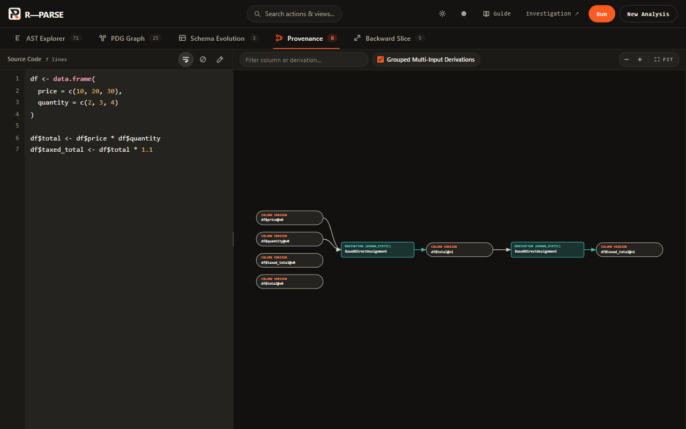
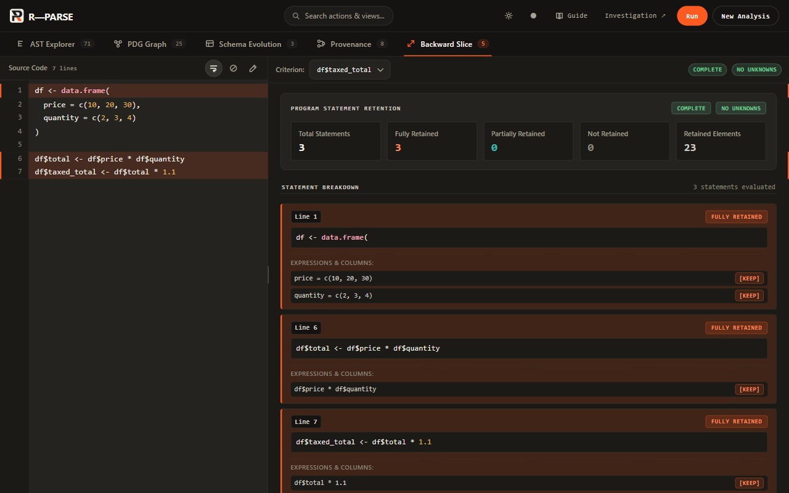
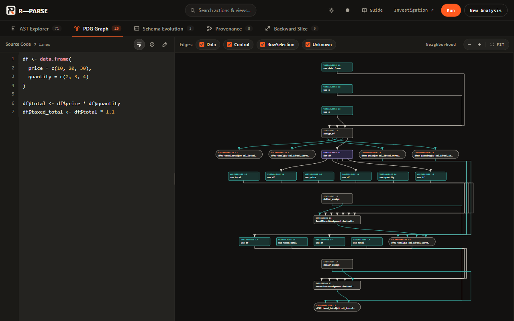
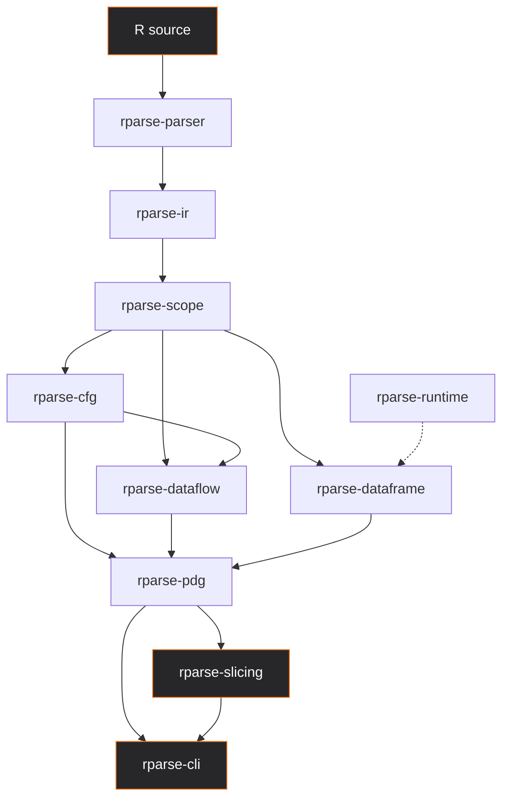

<p align="center">
  
</p>

<h1 align="center">R-PARSE</h1>

<p align="center">
  <strong>Understand R. Trace the Data.</strong><br>
  A Rust engine for parsing R programs and investigating dataframe column derivations through static analysis.
</p>

<p align="center">
  <a href="https://github.com/shlokbainee23/R-Parse/actions/workflows/ci.yml"></a>
  <a href="LICENSE"></a>
  
  
</p>

<p align="center">
  <a href="#quick-start">Quick start</a>
  · <a href="#how-it-works">Architecture</a>
  · <a href="#research-contribution">Research</a>
  · <a href="#documentation">Documentation</a>
</p>

**R-PARSE** (Robust R Language Parsing and Program Analysis Engine) parses R source, builds a program dependence graph, and uses that graph for column provenance and column-aware backward slicing. Static analysis is the default and does not run the script.

---

## The problem: following data through R

R programs often transform dataframes through assignments, derived columns, filters, and other operations. As a script grows, the origin of one value is easy to lose.

When an output looks unexpected, useful questions include:

- Where did this column come from?
- Which transformations contributed to its value?
- Which statements are relevant to a particular output?
- How are the program's structure and dependencies connected?

R-PARSE investigates those relationships for a bounded set of dataframe operations. It parses R, tracks column derivations, and slices the program back from a chosen criterion. It is an analysis engine, not an R interpreter, a linter, or a replacement for GNU R.

## What R-PARSE does

| Capability | What it answers |
|---|---|
| **Column provenance** | Which input columns derive a selected output column, and through which operations. |
| **Column-aware backward slicing** | Which statements and semantic elements are relevant to a selected criterion. |
| **Program structure** | How the script is represented as syntax, control flow, and a program dependence graph. |
| **Schema evolution** | How dataframe columns appear, change, and carry forward across supported transformations. |
| **Studio** | A local interface for the AST, PDG, schema evolution, provenance, and backward slice. |

Provenance and slicing are different questions. Provenance follows column derivation edges. Slicing selects the program elements needed for a criterion. The same column can be the target of both.

Results depend on the supported constructs below. Unsupported or dynamic code stays explicitly unknown instead of being guessed.

## See it in action

These captures are the current Studio, in its dark theme, analyzing the example in the next section with `rparse` 0.1.0 in static mode. They are screenshots of the running application.

**Column provenance.** `df$price` and `df$quantity` derive `df$total`, which derives `df$taxed_total`.



**Backward slicing.** The criterion `df$taxed_total` retains all three statements. The Studio reports confidence `COMPLETE`, no unknowns, and 23 retained semantic elements.



**Program dependence graph.** The same script as a PDG. Edge filters cover data, control, row selection, and unknown dependence. At the fitted zoom, some node labels are abbreviated; zoom in Studio to read them.



## A small example

This script creates a dataframe, derives `total`, and then derives `taxed_total` from it:

```r
df <- data.frame(
  price = c(10, 20, 30),
  quantity = c(2, 3, 4)
)

df$total <- df$price * df$quantity
df$taxed_total <- df$total * 1.1
```

Static provenance for `df$taxed_total`, from `rparse` 0.1.0, reports this chain:

```text
df$price ──────┐
               ├──> df$total ───> df$taxed_total
df$quantity ───┘
```

That diagram is a reading of the command output below, not a separate export format.

### Provenance

```text
R-PARSE COLUMN PROVENANCE
─────────────────────────
Target Column:     df$taxed_total (v2)
Certainty State:   KNOWN_STATIC

Direct Input Columns:
  ← df$total (v1)

Transitive Source Columns:
  ← df$price (v0)
  ← df$quantity (v0)

Derivation Chain:
  [BaseRDirectAssignment] df$total → df$taxed_total
  [BaseRDirectAssignment] df$price, df$quantity → df$total
```

### Backward slice

```text
R-PARSE BACKWARD STATIC SLICE
─────────────────────────────
Criterion:         df$taxed_total
Confidence:        COMPLETE
Contains Unknowns: NO

Slice Metrics:
  Retained Semantic Elements:  23
  Fully Retained Statements:    3
  Partially Retained Statements:0

Retained Program Statements:
  [FULL] Line 1:   df <- data.frame(
  [FULL] Line 6:   df$total <- df$price * df$quantity
  [FULL] Line 7:   df$taxed_total <- df$total * 1.1
```

The `data.frame(...)` call is one statement, so the slice lists it at line 1. Both later assignments are retained because each step is on the derivation path.

### Commands

From `implementation/`, with the script saved as `example.R`:

```powershell
cargo run -p rparse-cli -- analyze .\example.R
cargo run -p rparse-cli -- provenance .\example.R --column 'df$taxed_total'
cargo run -p rparse-cli -- slice .\example.R --criterion 'df$taxed_total' --format json
```

Quote column and criterion values in PowerShell so `$` is not expanded. `rparse help` lists the flags for the installed build. The main commands are `analyze`, `provenance`, `slice`, and `studio` (`serve` is an alias).

| Command | Required argument | Useful flags |
|---|---|---|
| `analyze` | `<FILE>` or `-` for stdin | `--format text\|json\|dot\|html`, `-o`, `--graph pdg\|provenance\|cfg\|ast`, `--mode`, `--seed` |
| `provenance` | `<FILE>` and `--column` | `--format text\|json\|html`, `-o`, `--mode`, `--seed` |
| `slice` | `<FILE>` and `--criterion` | `--format text\|json\|html`, `-o`, `--mode`, `--seed` |
| `studio` | optional `[FILE]` | `--port` (default `8080`), `--open` |

`--format dot` is only valid with `analyze --graph`. `--mode` accepts `static` (the default), `assisted`, or `execute`. `--seed DF=col1,col2` supplies an initial schema when discovery is not enough.

## How it works

Static analysis runs entirely in Rust. The optional GNU R bridge is invoked only in `assisted` or `execute` mode.



The order matches the static pipeline: parse to a concrete syntax tree, normalize to semantic IR, resolve scope, build the control-flow graph and dataflow facts, analyze dataframe schemas and column provenance, then build and validate the program dependence graph. Slicing and Studio read that result. `rparse-runtime` can attach runtime evidence in non-static modes. It does not replace the static graph, and static mode never starts it.

`rparse-core` holds shared types, spans, diagnostics, and errors. It is used across the pipeline rather than as its own stage.

### Workspace

| Crate | Responsibility |
|---|---|
| `rparse-core` | Foundational types, spans, diagnostics, and errors. |
| `rparse-parser` | Tree-sitter R parser and concrete syntax tree. |
| `rparse-ir` | Normalized semantic intermediate representation. |
| `rparse-scope` | Symbol and lexical scope analysis. |
| `rparse-cfg` | Control-flow graph. |
| `rparse-dataflow` | Reaching definitions, def-use, and control dependence. |
| `rparse-dataframe` | Schema versions and fine-grained column provenance. |
| `rparse-pdg` | Program dependence graph over dataflow, provenance, control, and row selection. |
| `rparse-slicing` | Column-aware static backward slicing over that graph. |
| `rparse-runtime` | Optional GNU R process bridge and runtime evidence. |
| `rparse-cli` | Commands, output formats, and the local Studio server. |

## Research contribution

The frozen project thesis is narrower than "an R parser":

> R-PARSE is a broad-compatibility R program analysis system that extends semantic program representation with fine-grained column provenance and uses that information to enable column-aware static program slicing.

Two capabilities carry that thesis:

1. **Column provenance.** Input-to-output column derivation edges, kept distinct from merely recording that a column name exists.
2. **Column-aware static backward slicing.** The statements, expressions, and column versions that contribute to a selected column or other criterion.

The scope was fixed after comparative research, gap analysis, adversarial checks, and an architecture decision for a Rust analysis core plus an optional GNU R bridge. Novelty and comparison with related systems should be read from the research documents, not inferred from this feature list.

## Quick start

### Prerequisites

- The stable Rust toolchain used by CI, with Cargo. The workspace uses Rust edition 2021. There is no pinned minimum version in the repository.
- GNU R is required only for `--mode assisted` and `--mode execute`. Static mode does not need it. The runtime bridge looks for `Rscript` or `R` on `PATH`, or under `R_HOME`.

### Windows: start the Studio

From the repository root:

```powershell
git clone https://github.com/shlokbainee23/R-Parse.git
cd R-Parse
.\start.ps1
```

`start.ps1` runs `cargo run -p rparse-cli -- studio --open` from `implementation/`. The server prints:

| | |
|---|---|
| Landing page | http://localhost:8080 |
| Studio | http://localhost:8080/studio |
| Health | http://localhost:8080/api/health |

`--open` opens the landing page. If a healthy server is already on port 8080, the script opens the Studio URL instead. The analysis engine for this server is static. Stop it with Ctrl+C in that terminal.

### Build and run the CLI

From `implementation/`:

```powershell
cargo build --workspace --release
.\target\release\rparse.exe --help
.\target\release\rparse.exe studio --open
```

On macOS and Linux the release binary is `target/release/rparse`. The same `cargo run -p rparse-cli -- ...` commands work from `implementation/` on each platform. Choose another port with `--port`, or with the `PORT` environment variable. `HOST` changes the bind address; the default bind is `0.0.0.0`, and the printed links use `localhost`.

Pass a script to preload it:

```powershell
cargo run -p rparse-cli -- studio .\example.R
```

## Analysis modes and limitations

| Mode | Behavior |
|---|---|
| `static` | Default. Parses and analyzes in Rust. Does not start GNU R. Runtime evidence stays absent. |
| `assisted` | Static analysis remains primary. The runtime bridge may observe dataframe state in GNU R. |
| `execute` | Also asks GNU R to evaluate the script, then records runtime observations. |

Runtime observation does not turn an unknown static dependency into a known one. It records evidence from that run.

Static analysis covers a bounded dataframe vocabulary:

- `mutate`, `transmute`, `select`, `rename`, `filter`, and `transform`
- Base R column assignment such as `df$col <- ...`, and basic column projection

It does not model the whole tidyverse, `data.table` update semantics, or reshape verbs such as `pivot_longer` and `pivot_wider`. Formula semantics and ggplot2 aesthetics are outside the frozen core. Dynamic names, unmodeled calls, and other unresolved constructs are reported as `UNKNOWN_STATIC` rather than filled in.

A slice can retain part of one statement and drop another part, for example one `mutate` assignment and not its sibling. Confidence and unknown flags in the slice output say how complete that result is.

R-PARSE is not a full semantic model of every R program, and a slice is not guaranteed to be a standalone executable script.

## Testing and continuous integration

[](https://github.com/shlokbainee23/R-Parse/actions/workflows/ci.yml)

[`.github/workflows/ci.yml`](.github/workflows/ci.yml) runs on Ubuntu, Windows, and macOS for pushes and pull requests to `master` and `main`. From `implementation/`, the commands are:

```bash
cargo fmt --all --check
cargo check --workspace
cargo test --workspace
cargo clippy --workspace --all-targets --all-features -- -D warnings
cargo build --workspace --release
```

Formatting is a separate Ubuntu job. The matrix job checks the workspace, runs tests, runs Clippy with warnings denied, and builds the release binaries. Clippy is the step that passes `--all-features`. The workspace does not define extra Cargo features.

## Documentation

- [Architecture decision](research/ADR-001-architecture.md) — Rust analysis core and optional GNU R bridge
- [Scope freeze](research/scope-freeze.md) — authoritative project boundary
- [Technical specification](research/technical-specification.md) — engineering design
- [Research reference landscape](research/reference-landscape.md)
- [Deep flowR gap audit](research/flowr-deep-gap-audit.md)
- [Final research report](research/FINAL-RESEARCH-REPORT.md)
- [Research index](research/README.md)

Earlier research notes that say the scope is still open are superseded by the scope freeze.

## Roadmap

The scope freeze is the boundary for current work. Further development is aimed at:

- Broader, still explicit coverage of column provenance
- Column-aware slicing across more of the supported R constructs
- More adversarial and regression tests
- Clearer Studio views
- Clearer documentation of static limits and runtime-assisted behavior

Those items are not claims about what the current build already does. Formula analysis, ggplot2 semantics, editor integration, a full interpreter, and a guaranteed executable reprex are outside the frozen core.

## Contributing

Issue reports and small reproducible examples are welcome. Include a short R script, the command or Studio view, the result you expected, and the result you saw. Leave out confidential data and secrets.

## License

R-PARSE is released under the [MIT License](LICENSE).

[THIRD_PARTY_NOTICES.md](THIRD_PARTY_NOTICES.md) lists notices for included and linked third-party components.

---

<p align="center">
  <strong>R-PARSE</strong><br>
  <em>Understand R. Trace the Data.</em>
</p>
