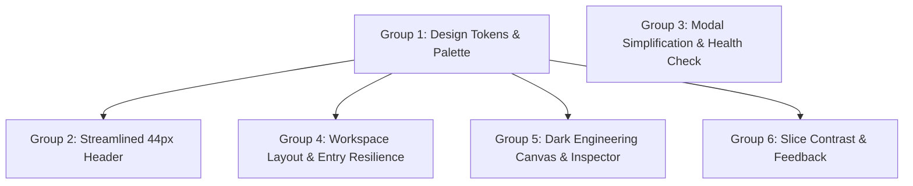

# R-PARSE — Visual Quality Engineering Remediation Plan

**Purpose:** Comprehensive, logically phased plan to resolve all visual, structural, and usability defects identified in the Phase 1 Forensic Audit. Groups related issues into coherent architectural clusters rather than piecemeal CSS patches.

---

## Remediation Roadmap Overview

```
Phase 1: AUDIT COMPLETE (Current Status — Zero Application Changes)
  │
  ├──► Group 1: Visual Identity & Design Token Unification
  │      └── Establish dark engineering token palette matching landing craft
  │
  ├──► Group 2: Studio Header & Navigation Architecture
  │      └── Collapse 76px 2-row header into unified 44px bar; fix 768px overflow
  │
  ├──► Group 3: Studio Launch Modal Simplification & Health Truth
  │      └── Eliminate documentation clutter; implement truthful offline handling
  │
  ├──► Group 4: Workspace Layout & Entry Container Resilience
  │      └── Fix entry card clipping; stabilize source viewer & edit mode
  │
  ├──► Group 5: Visualization Canvas & Non-Obscuring Inspector
  │      └── Add engineering grid; prevent inspector from covering active nodes
  │
  └──► Group 6: Interactive Feedback & Dead UI Remediation
         └── Fix schema diff legend affordance; boost slice contrast (<1.4:1 -> 4.5:1)
```

---

## Work Group 1: Visual Identity & Design Token Unification

### Objectives
- Bridge the aesthetic schism between the cinematic dark Landing Page and the light ivory Studio workspace.
- Eliminate arbitrary token aliasing (`--accent-blue: #FF5A1F`) and inconsistent purple/lilac values.
- Establish a single, shared design token foundation (`tokens.css` or embedded `:root` contract).

### Issues Addressed
- `ISSUE-P1-01`: Aesthetic Schism Between Landing and Studio ("Two Different Products").
- `ISSUE-P2-01`: Arbitrary Token Aliasing & Inconsistent Colorway (`--accent-blue: #FF5A1F`).
- `ISSUE-P1-03`: Excessive Rectangular Containers & Border Gridlock.

### Target Files
- [`format_html_assets.rs:L10-L75`](file:///c:/Users/thimm/OneDrive/Desktop/Rparse/implementation/crates/rparse-cli/src/format_html_assets.rs#L10-L75) (Studio CSS `:root`)
- [`landing/styles.css:L10-L70`](file:///c:/Users/thimm/OneDrive/Desktop/Rparse/landing/styles.css#L10-L70) (Landing CSS `:root`)

### Proposed Changes
1. **Define Core Surface Hierarchy:**
   ```css
   --bg-canvas: #121216;       /* Deepest graph canvas backdrop */
   --bg-panel: #18181E;        /* Header, sidebar, viewer panels */
   --bg-surface: #22222A;      /* Cards, toolbars, elevated elements */
   --bg-surface-hover: #2B2B35;
   --border-subtle: rgba(255, 255, 255, 0.08);
   --border-strong: rgba(255, 255, 255, 0.16);
   ```
2. **Standardize Accent System:**
   ```css
   --accent-primary: #FF5A1F;          /* Signal Orange (Primary CTAs, Brand) */
   --accent-dataflow: #B8A6FF;         /* Glowing Lilac (Data dependencies, RowSelection) */
   --accent-emerald: #059669;          /* Emerald (Known Static, Fully Retained [KEEP]) */
   --accent-amber: #F59E0B;            /* Amber (Static Uncertainty UNKNOWN_STATIC, Warnings) */
   --accent-rose: #EF4444;             /* Rose (Syntax Errors, Dropped Code [DROP]) */
   --accent-blue: var(--accent-primary); /* Deprecated legacy alias for test assertion compatibility */
   ```
3. **Harmonize Typography & Radius:**
   Enforce `Plus Jakarta Sans` for UI copy, `JetBrains Mono` for source code and metadata, and standardized radii (`--radius-sm: 4px`, `--radius-md: 8px`, `--radius-lg: 14px`).

---

## Work Group 2: Studio Header & Navigation Architecture

### Objectives
- Eliminate vertical canvas waste by collapsing the 76px 2-row header into a single, high-efficiency 44px bar.
- Permanently resolve the horizontal overflow bug (`ISSUE-P0-02`) at <=880px viewports.
- Clear cognitive clutter by demoting secondary statement counters into the Evidence Drawer.

### Issues Addressed
- `ISSUE-P0-02`: Studio Header Top-Row Horizontal Overflow at <=880px Viewports.
- `ISSUE-P1-02`: Redundant Two-Row Studio Header Consuming Permanent Canvas Real Estate.
- `ISSUE-P1-06`: Competing & Cluttered Status Metrics in Header Top Row.
- `ISSUE-P3-02`: Subnav Tab Count Badges Show Low-Value "0".
- `ISSUE-P3-04`: Hardcoded Inline Styles on External Navigation Links.

### Target Files
- [`format_html_assets.rs:L1783-L1848`](file:///c:/Users/thimm/OneDrive/Desktop/Rparse/implementation/crates/rparse-cli/src/format_html_assets.rs#L1783-L1848) (HTML Markup)
- [`format_html_assets.rs:L140-L245`](file:///c:/Users/thimm/OneDrive/Desktop/Rparse/implementation/crates/rparse-cli/src/format_html_assets.rs#L140-L245) (CSS Styles)

### Proposed Changes
1. **Single-Row 44px Flex Layout:**
   - **Left:** Brand logo `R—PARSE`, slash separator, file breadcrumb with auto-truncation (`max-width: 200px; text-overflow: ellipsis;`).
   - **Center:** The 5 analytical tabs (`Provenance`, `PDG`, `Slice`, `Schema`, `AST`) centered in the bar. Remove individual empty "0" count pills.
   - **Right:** Quiet status dot + label (`● Ready` / `▲ Uncertainty`), `Evidence` button, and `New Analysis` button.
2. **Responsive Degradation at Narrow Viewports:**
   - At `<1024px`: Demote filename into a tooltip, collapse tab text to icon-only with tooltips.
   - At `<768px`: Keep `New Analysis` and status indicator fixed on right; move tab navigation into a compact dropdown.

---

## Work Group 3: Studio Session Modal Simplification & Health Truth

### Objectives
- Synchronize divergent modal implementations across `index.html` and `landing/index.html`.
- Transform the modal from a dense documentation manual into a focused, high-intent launch dialog.
- Implement truthful health checks: disable the launch button when the daemon is offline and clearly show the 1-click CLI launch command.

### Issues Addressed
- `ISSUE-P0-04`: Divergent Studio Modal Markup and False Offline Handling.
- `ISSUE-P1-04`: Studio Session Modal Technical Over-Documentation & Hierarchy Inversion.

### Target Files
- [`landing/index.html:L740-L820`](file:///c:/Users/thimm/OneDrive/Desktop/Rparse/landing/index.html#L740-L820)
- [`index.html:L800-L840`](file:///c:/Users/thimm/OneDrive/Desktop/Rparse/index.html#L800-L840)
- [`landing/investigation.js:L350-L380`](file:///c:/Users/thimm/OneDrive/Desktop/Rparse/landing/investigation.js#L350-L380)

### Proposed Changes
1. **Modal Content Pruning:**
   - Remove the 4 verbose capability bullets (already covered in Section 05).
   - Remove the secondary 4-command CLI terminal blocks.
2. **Two Clean Modal States:**
   - **State A (Daemon Active):** Large emerald LED `● Local Studio Daemon Active on 127.0.0.1:8080`, followed immediately by high-emphasis primary button: `Open Studio Session ↗`.
   - **State B (Daemon Offline):** Status badge `○ Studio Daemon Offline`, single terminal box `rparse studio --port 8080 --open` with 1-click copy button, and disabled button `Start Daemon to Launch`.
3. **Synchronize Markup:** Replace root `index.html` modal with the unified template.

---

## Work Group 4: Workspace Split & Entry Container Resilience

### Objectives
- Resolve the critical validation error overflow bug (`ISSUE-P0-01`) on the code entry screen.
- Improve source code typography, readability, and syntax inspection line height.
- Smooth out the transition between syntax-highlighted viewer and source edit mode.

### Issues Addressed
- `ISSUE-P0-01`: Entry Screen Container Vertical Overflow on Validation Error.
- `ISSUE-P2-02`: Source Code Viewer Line Height, Wrapping Jitter, and Edit Mode Replacement.
- `ISSUE-P2-03`: Stale Source Banner Layout Shift and Clashing Amber Theme.
- `ISSUE-P3-01`: Splitter Resize Handle Lacks Visual Affordance.

### Target Files
- [`format_html_assets.rs:L1732-L1778`](file:///c:/Users/thimm/OneDrive/Desktop/Rparse/implementation/crates/rparse-cli/src/format_html_assets.rs#L1732-L1778) (Entry Screen Markup)
- [`format_html_assets.rs:L65-L105`](file:///c:/Users/thimm/OneDrive/Desktop/Rparse/implementation/crates/rparse-cli/src/format_html_assets.rs#L65-L105) (Entry Screen CSS)
- [`format_html_assets.rs:L300-L405`](file:///c:/Users/thimm/OneDrive/Desktop/Rparse/implementation/crates/rparse-cli/src/format_html_assets.rs#L300-L405) (Source Viewer CSS)

### Proposed Changes
1. **Entry Screen Layout Fix:**
   - Add `overflow-y: auto; max-height: 100vh; padding: 32px 16px;` to `.entry-screen`.
   - Set `.entry-card { margin: auto; max-height: calc(100vh - 64px); display: flex; flex-direction: column; }`.
   - Ensure the actions bar is always pinned or scrollable within the card.
2. **Source Code Readability Enhancement:**
   - Increase `.source-line` line-height from `1.35` to `1.55`.
   - In edit mode, retain gutter line numbers alongside the textarea to prevent layout shift.
3. **Stale Indicator Relocation:**
   - Move stale banner out of the code flow and place a quiet, non-shifting warning pill in `.pane-header` (`⚠️ Modified (Reanalyze / Revert)`).
4. **Splitter Handle Polish:**
   - Add a 2px center grab rule that turns Signal Orange on hover.

---

## Work Group 5: Visualization Canvas & Non-Obscuring Inspector

### Objectives
- Prevent the Contextual Inspector from sliding over active graph nodes (`ISSUE-P0-03`).
- Upgrade the canvas background from a flat plain wash into a dark precision engineering dot matrix.
- Refine SVG graph node styling, edge routing, and label readability.

### Issues Addressed
- `ISSUE-P0-03`: Contextual Inspector Overlay Obscures Active Graph Nodes.
- `ISSUE-P2-04`: Missing Technical Canvas Engineering Grid / Dot Matrix.
- `ISSUE-P2-06`: Graph Node Label Truncation and Overlapping Bezier Edges in PDG.

### Target Files
- [`format_html_assets.rs:L1958-L2046`](file:///c:/Users/thimm/OneDrive/Desktop/Rparse/implementation/crates/rparse-cli/src/format_html_assets.rs#L1958-L2046) (Canvas & Inspector Markup)
- [`format_html_assets.rs:L515-L615`](file:///c:/Users/thimm/OneDrive/Desktop/Rparse/implementation/crates/rparse-cli/src/format_html_assets.rs#L515-L615) (Canvas & Inspector CSS)
- [`format_html_assets.rs:L2500-L2800`](file:///c:/Users/thimm/OneDrive/Desktop/Rparse/implementation/crates/rparse-cli/src/format_html_assets.rs#L2500-L2800) (SVG Graph Generation JS)

### Proposed Changes
1. **Non-Obscuring Inspector Layout:**
   - Transition `.contextual-inspector` from `position: absolute` into a collapsible flex pane (`flex: 0 0 320px; transition: width 0.25s var(--ease-spring);`), OR
   - When a node is selected, compute its bounding box; if `node.right > canvas.width - 340`, trigger an automatic smooth pan offset so the node remains clearly visible to the left of the inspector.
2. **Engineering Dot-Matrix Canvas Grid:**
   - Add a subtle 24px dot grid pattern (`radial-gradient(rgba(255, 255, 255, 0.08) 1px, transparent 1px)`).
3. **PDG Node Sizing & Label Formatting:**
   - Cap SVG text length at 28 characters with ellipsis `…`; provide complete un-truncated expression in inspector.

---

## Work Group 6: Interactive Feedback & Dead UI Remediation

### Objectives
- Resolve Dead UI affordance on Schema Evolution diff legend badges (`ISSUE-P1-05`).
- Boost contrast and scannability of Backward Slicing retained vs dropped code fragments (`ISSUE-P2-05`).
- Standardize button variants and remove inline styles.

### Issues Addressed
- `ISSUE-P1-05`: Schema Evolution Diff Legend Badges Resemble Clickable Interactive Filters (Dead UI).
- `ISSUE-P2-05`: Weak Contrast & Low Readability of Backward Slicing Retention Highlights.
- `ISSUE-P3-03`: Inconsistent Button Styles and Padding Across Panels.

### Target Files
- [`format_html_assets.rs:L1945-L1956`](file:///c:/Users/thimm/OneDrive/Desktop/Rparse/implementation/crates/rparse-cli/src/format_html_assets.rs#L1945-L1956) (Schema Toolbar)
- [`format_html_assets.rs:L430-L510`](file:///c:/Users/thimm/OneDrive/Desktop/Rparse/implementation/crates/rparse-cli/src/format_html_assets.rs#L430-L510) (CSS Diff Badges & Slice Highlights)

### Proposed Changes
1. **Schema Diff Badges Affordance Clarification:**
   - Style diff indicators as a quiet legend (`Legend: +added -removed ~modified =retained`) with flat text and colored square swatches, removing pill borders that mimic interactive filter buttons.
2. **Backward Slice Retention Contrast Enhancement:**
   - In the dark theme, render `[KEEP]` lines with a crisp left emerald border (`3px solid #059669`) and subtle green background glow (`rgba(5, 150, 105, 0.12)`).
   - Render `[DROP]` lines with dimmed text opacity (`0.45`) and subtle strikethrough, creating instant visual differentiation (>4.5:1 contrast).

---

## Execution Phasing & Dependency Graph



All 6 groups are strictly confined to presentation assets (`format_html_assets.rs`, `landing/index.html`, `landing/styles.css`, `landing/investigation.js`). Zero changes to Rust core analysis algorithms or CLI argument contracts are required.
